# Architecture

Every diagram is a rendered image in [diagrams/](diagrams/) with its [Mermaid](https://mermaid.js.org/) source in a collapsible block (so it also renders natively on GitHub). The code paths that implement each one are named under it.

## 1. System context

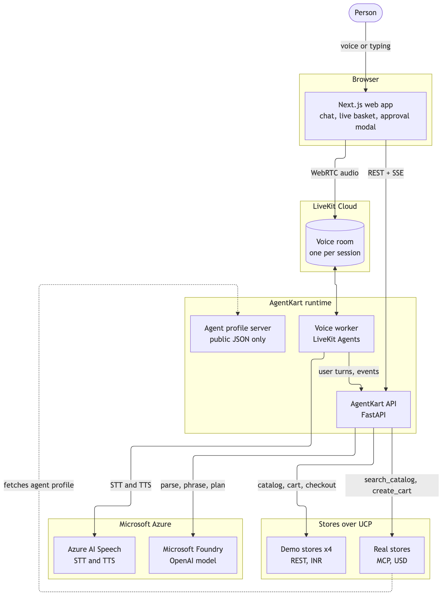

Mermaid source

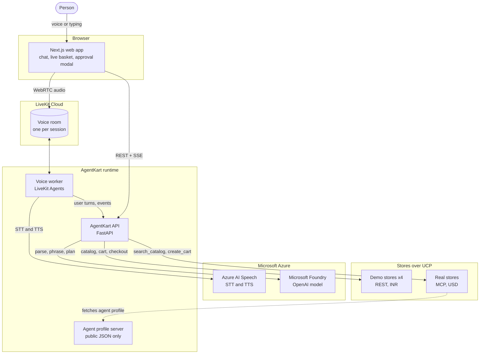

Code: `web/`, `voice/worker.py`, `agent/app/main.py`, `agent/app/llm.py`, `stores/server.py`, `agent/app/real_stores/`, `agent_profile/serve.py`.

## 2. API components

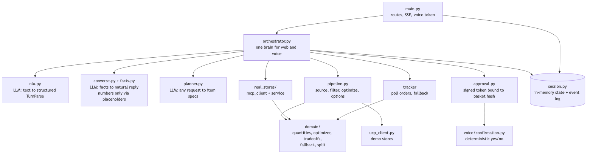

Mermaid source

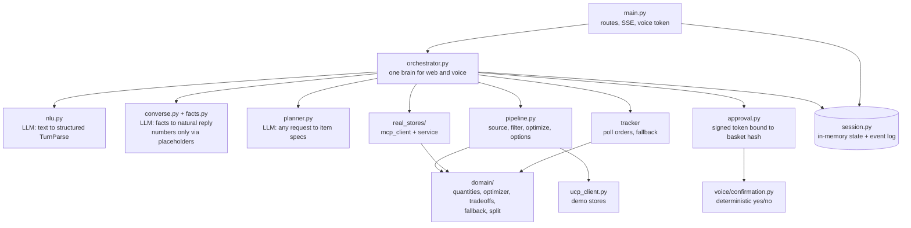

The three boxes that call a model (`nlu`, `converse`, `planner`) never compute money or quantities. `domain/` is pure Python with no network or model access.

## 3. One conversational turn

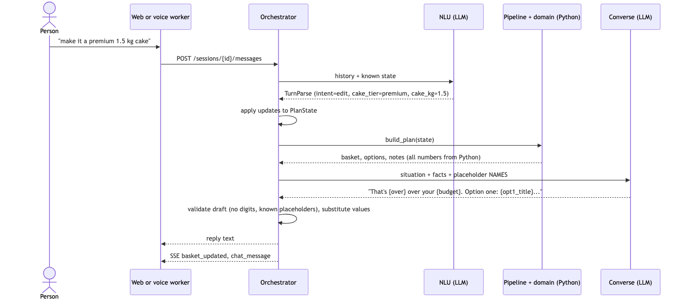

Mermaid source

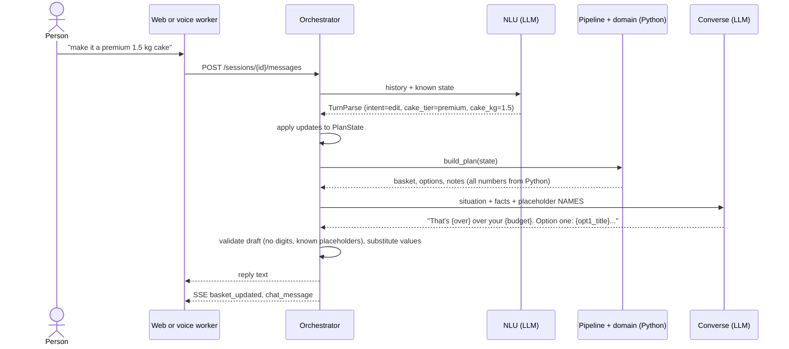

If the draft contains its own digits, an unknown placeholder, or the call fails, the deterministic text from `narrate.py` is used instead.

## 4. Approval gate and spoken confirmation

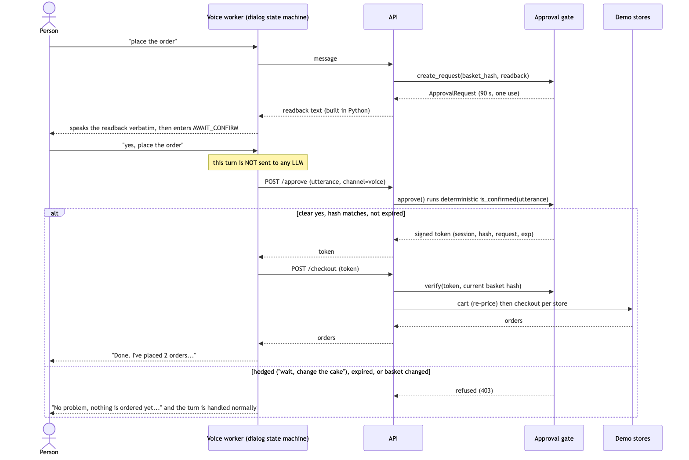

Mermaid source

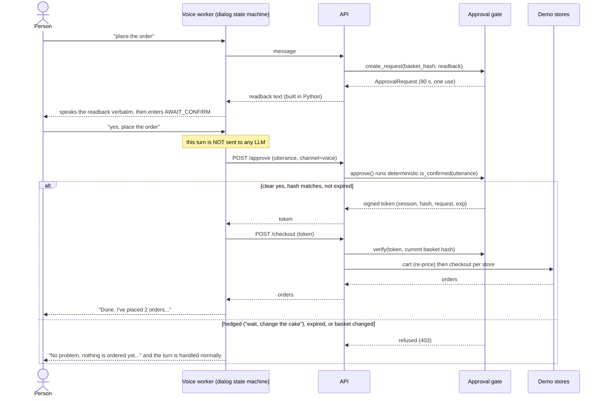

The same gate serves the on-screen **Approve** button (`channel: web`). Any basket edit or address change invalidates pending requests.

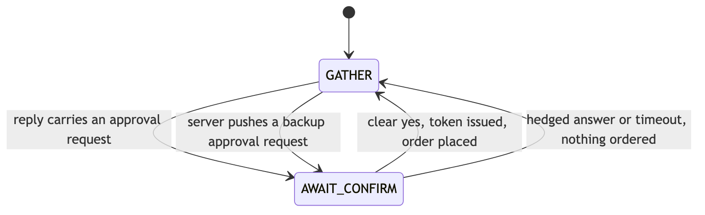

Mermaid source

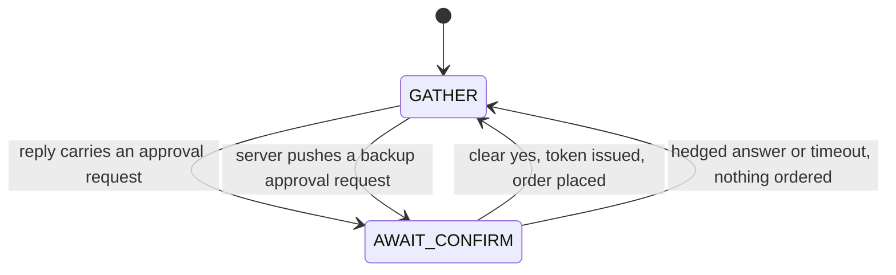

Code: `agent/app/approval.py`, `voice/confirmation.py`, `voice/dialog.py`, `agent/app/orchestrator.py` (`checkout`).

## 5. Real stores over UCP: search, cart, handoff

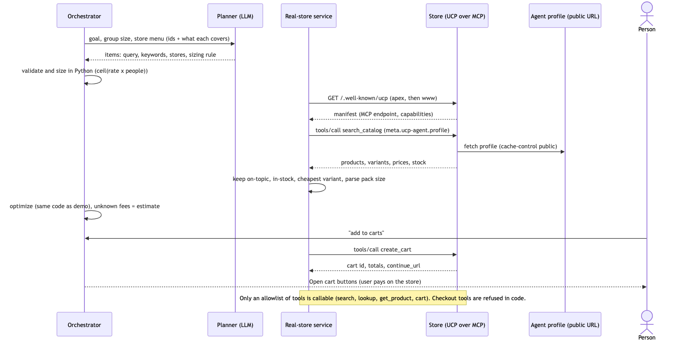

Mermaid source

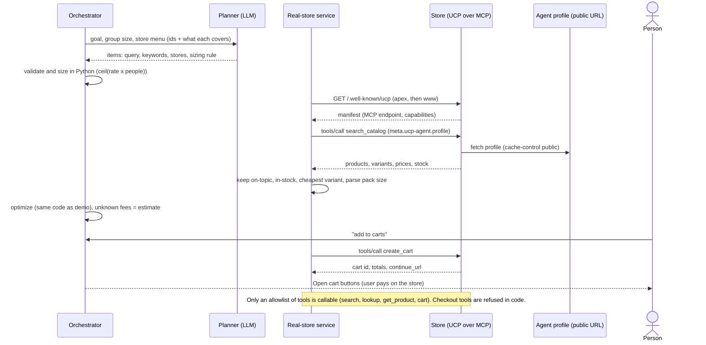

Code: `agent/app/real_stores/mcp_client.py` (allowlist), `agent/app/real_stores/service.py`, `agent/app/planner.py`.

## 6. Dynamic planning (real stores)

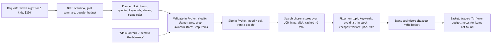

Mermaid source

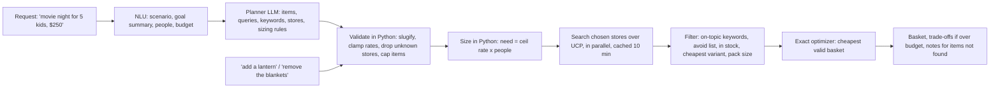

## 7. Delay, fallback and backup order

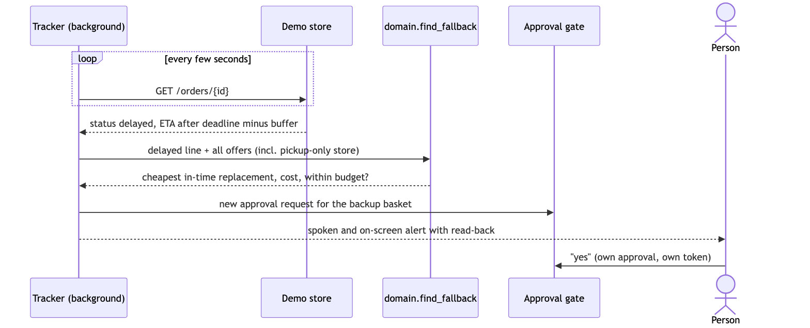

Mermaid source

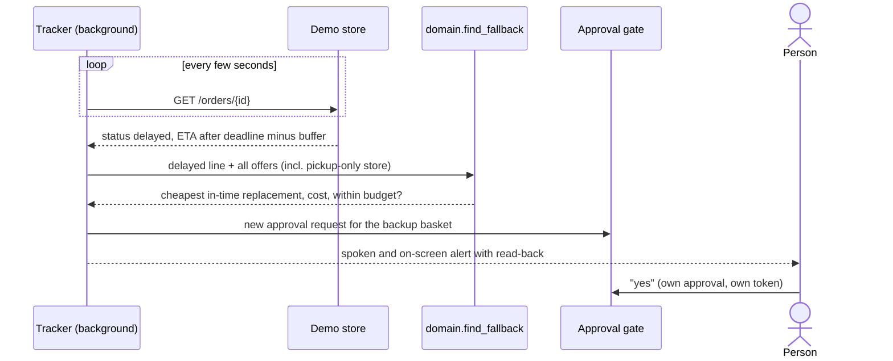

## 8. Data model (shared contracts)

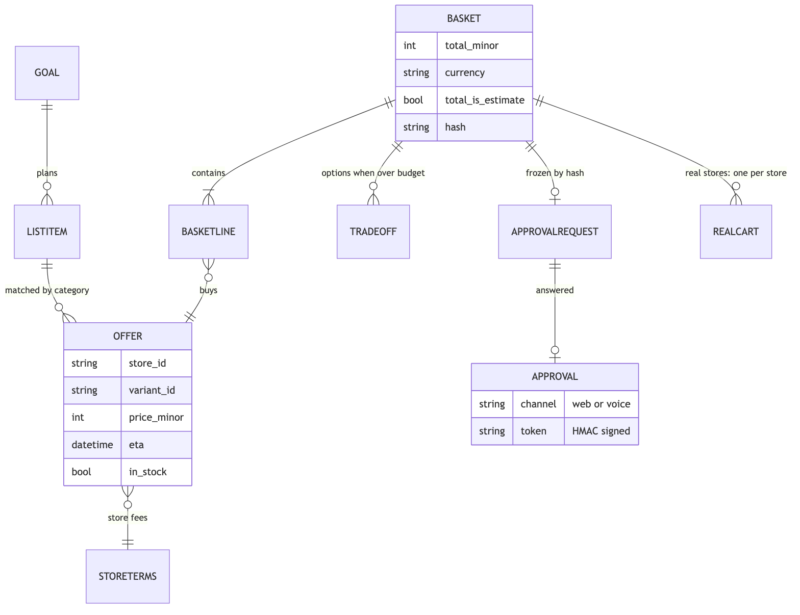

Mermaid source

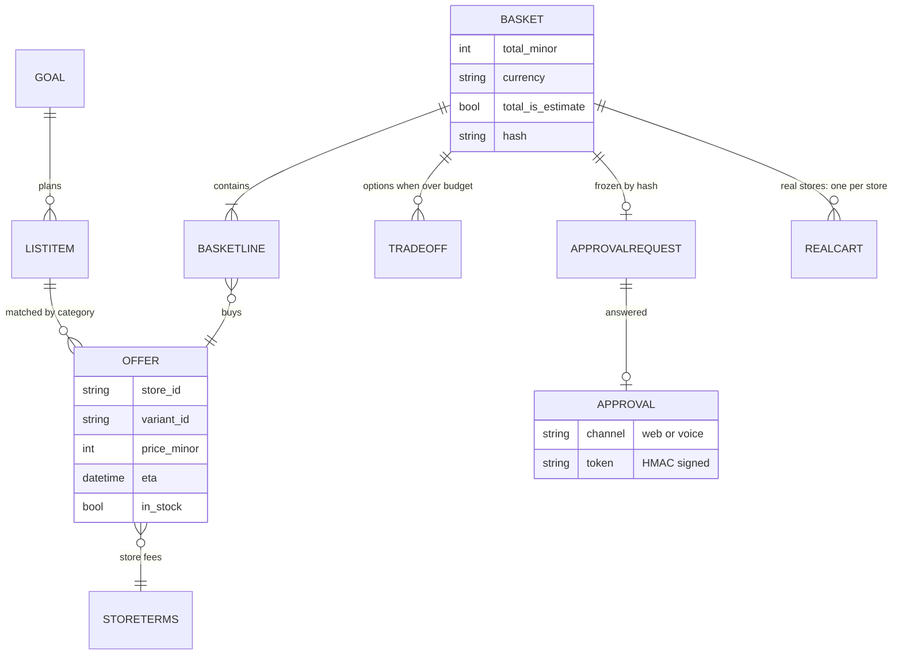

Money is always integer minor units plus a currency. The basket `hash` is a SHA-256 over lines, fees, discounts, total and currency (`contracts/hashing.py`).

## 9. Deployment

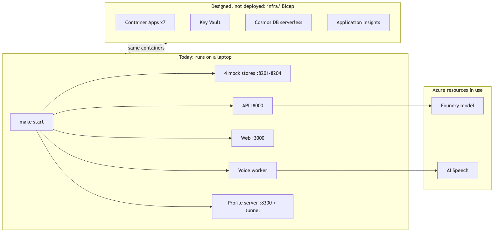

Mermaid source

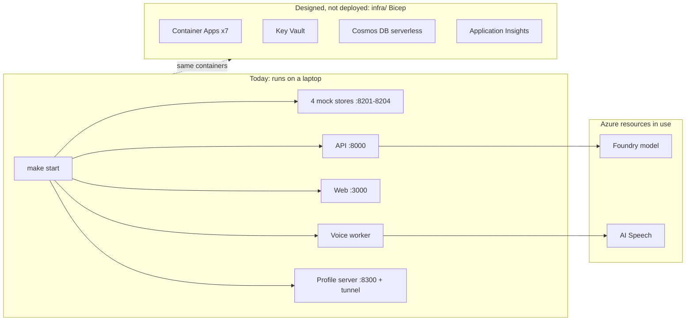

