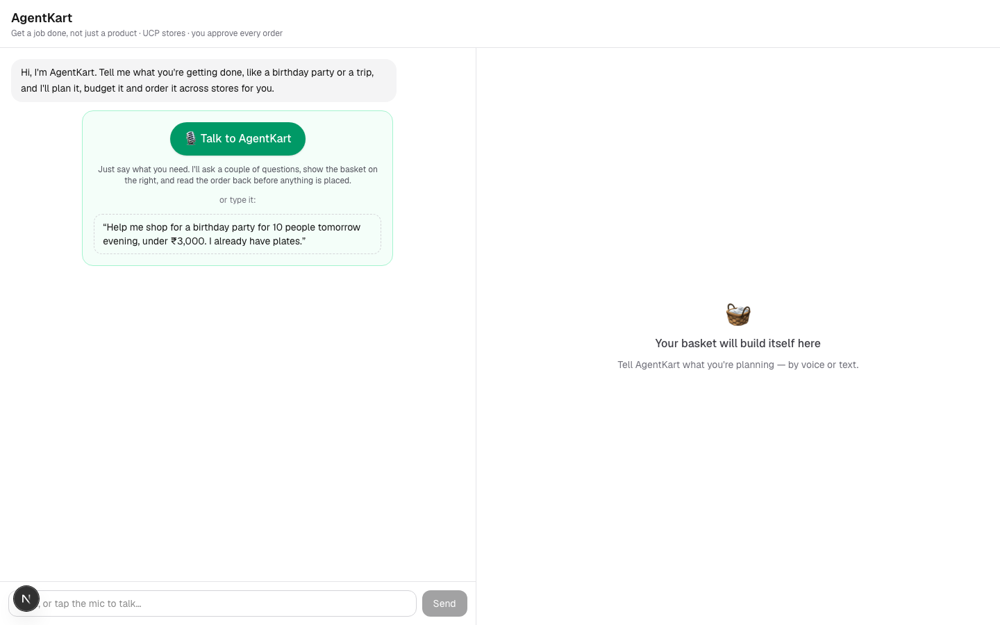
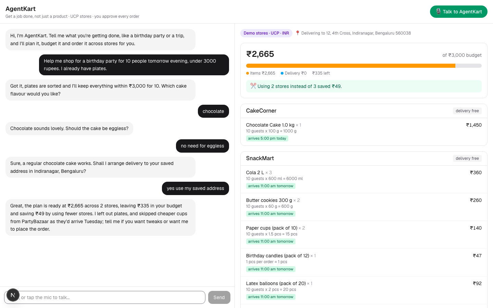
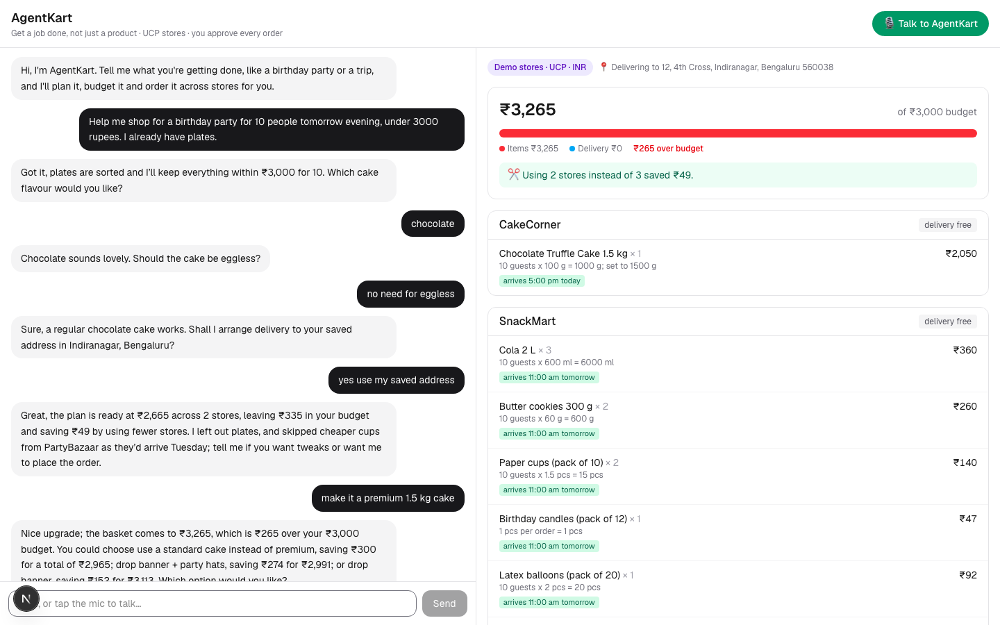
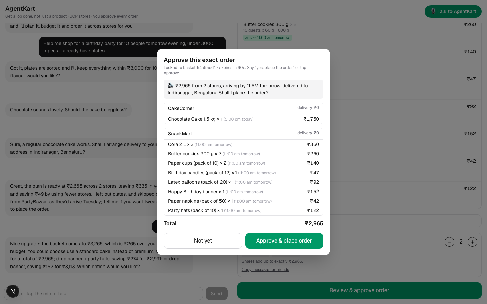
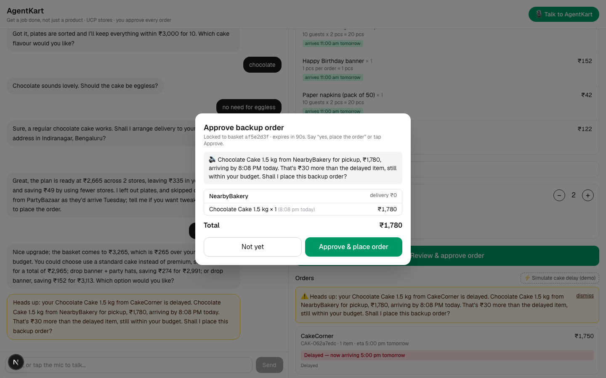
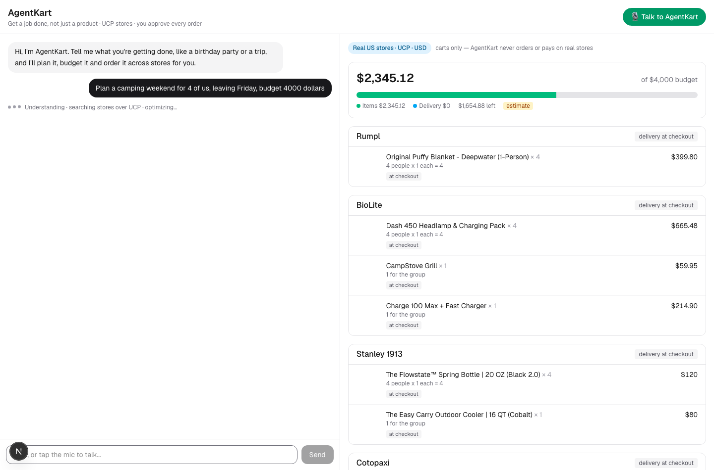
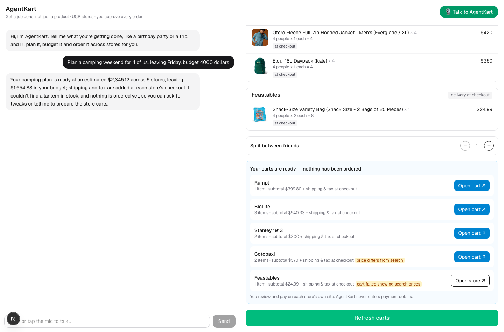

# Solution overview

## The problem
Shopping assistants help you buy **a product**. Real life is **a job**: a birthday party for ten tomorrow under ₹3,000, a camping
weekend for four, a first apartment. Doing the job means deciding what to buy, how much of each, from which stores, whether it arrives
in time, whether it fits the budget once delivery fees are counted, and splitting the cost. People do this across five tabs and a
calculator.

## The solution
AgentKart takes the **goal** in one spoken or typed sentence and does the whole job:

1. **Understands** the request and asks only for what is missing, one natural question at a time.
2. **Plans the list** and the **quantities** ("10 guests x 600 ml = 6000 ml", rounded up to whole packs).
3. **Shops across stores** over the open Universal Commerce Protocol (UCP), and finds the cheapest valid basket including delivery
   fees, free-delivery thresholds and minimum orders (an exact optimizer, not a heuristic).
4. **Respects the deadline** (an offer that arrives too late is excluded and explained) and the **budget** (when over, it offers
   trade-offs such as "use a standard cake instead of premium, saves ₹300").
5. **Splits the cost** between friends, with shares that add up exactly.
6. **Asks before it acts.** It reads the exact order back and places it only after a clear yes, spoken or clicked.
7. **Keeps watching.** If an order is delayed past the deadline it speaks up with an in-time backup, which needs its own approval.

Two store modes share one brain:

| Mode | Stores | Currency | What the agent does |
|---|---|---|---|
| **Demo stores** | four mock UCP merchants (CakeCorner, SnackMart, PartyBazaar, NearbyBakery) | INR | plans, then **places the order** after your approval, tracks it, handles delays |
| **Real stores** | live US stores from `config/real_stores.yaml`, over UCP/MCP | USD | plans from live catalogs, **adds everything to carts** and hands you each store's cart link. **It never orders or pays.** |

## User journey (demo stores)
| Step | What happens | Screenshot |
|---|---|---|
| Start | The agent greets you; talk or type |  |
| Plan | Three short questions, then a basket with quantity rules, per-store delivery, ETAs and a savings callout |  |
| Over budget | "Make it a premium 1.5 kg cake" goes over; three ranked trade-offs appear |  |
| Approve | The server-built read-back is spoken verbatim; say "yes, place the order" or click Approve |  |
| After purchase | A simulated delay triggers a backup proposal that needs its own approval |  |

## User journey (real stores)
Say "plan a camping weekend for 4, budget 4,000 dollars". The agent works out the list itself, searches the real stores over UCP, and
shows real products, photos and prices (estimates, with shipping and tax at the store's own checkout). "Add to carts" creates a real
cart per store and shows an **Open cart** button for each. You review and pay on the store's site.

## What is dynamic and what is not
- **Dynamic:** for real stores, an LLM planner proposes the items, search queries, store routing and sizing rules for **any** request;
  Python validates and computes. You can edit by talking ("add a lantern", "remove the blankets"). Prices, stock and photos are live.
- **Fixed:** the demo birthday uses a template and mock catalogs (a fixture). The list of real stores is curated in
  `config/real_stores.yaml` (family-friendly brands only).

## Design principles
1. **LLMs handle language, Python handles numbers.** Models parse speech and phrase replies; every quantity, price, fee, total and
   split comes from deterministic, tested code.
2. **A human approves every order.** Enforced in code, not by prompt (see [security](security-and-responsible-ai.md)).
3. **Open standards.** Every store, mock or real, is discovered through `/.well-known/ucp`.
4. **Honest about uncertainty.** Real totals are labelled estimates; degraded steps show a badge; unknown things are reported, not hidden.
5. **Voice is a surface, not a second brain.** Typed and spoken turns go through the same orchestrator.

## Technology
| Layer | Technology |
|---|---|
| Reasoning | OpenAI model on **Microsoft Foundry** via the `openai` SDK (`AzureOpenAI`) |
| Voice | **LiveKit** Agents (WebRTC rooms) with **Azure AI Speech** STT/TTS and Silero VAD |
| API | Python 3.12, FastAPI, Pydantic v2, server-sent events |
| Commerce | UCP: REST binding for the demo stores, MCP (JSON-RPC) for real stores |
| Web | Next.js 16 (App Router), React 19, TypeScript, Tailwind, `@livekit/components-react` |
| Quality | pytest + hypothesis, ruff, deterministic evals, Playwright end-to-end checks |

## Repository layout
| Path | Purpose |
|---|---|
| `domain/` | pure logic: templates, quantities, optimizer, trade-offs, fallback, split |
| `agent/app/` | API, orchestrator, NLU, conversation layer, planner, approval gate, tracker |
| `agent/app/real_stores/` | UCP-over-MCP client and real-store service |
| `stores/` | mock UCP merchants and order simulator |
| `voice/` | LiveKit worker, confirmation gate, dialog state machine |
| `web/` | Next.js app |
| `contracts/` | shared Pydantic models and the basket hash |
| `agent_profile/` | the public UCP agent profile served to real stores |
| `config/` | real-store list |
| `infra/` | Bicep for the Azure base services (not deployed) |
| `evals/`, `scripts/` | deterministic evals and end-to-end/demo scripts |
